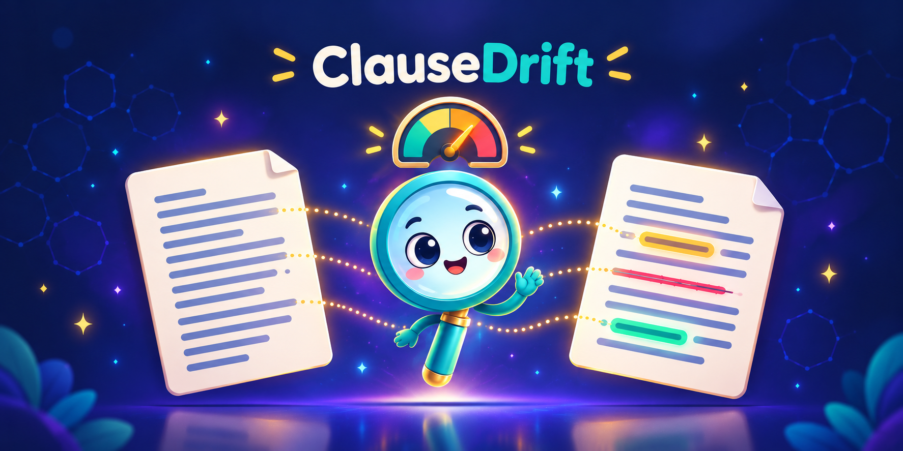
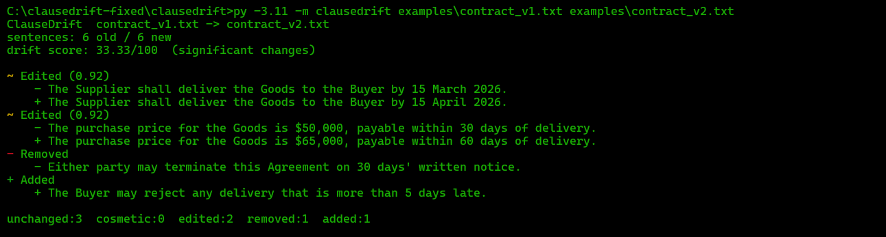

# ClauseDrift

**Explainable drift detection for AI-generated text.**

When you change a prompt, swap a model, or bump a temperature, the output
shifts. `git diff` can't tell you whether the *meaning* changed or just the
wording. ClauseDrift compares two versions of generated text and tells you,
sentence by sentence, exactly what changed and how much it matters.

```
$ clausedrift examples/contract_v1.txt examples/contract_v2.txt

ClauseDrift  contract_v1.txt -> contract_v2.txt
sentences: 6 old / 6 new
drift score: 33.33/100  (significant changes)

~ Edited (0.92)
    - The Supplier shall deliver the Goods to the Buyer by 15 March 2026.
    + The Supplier shall deliver the Goods to the Buyer by 15 April 2026.
~ Edited (0.92)
    - The purchase price for the Goods is $50,000, payable within 30 days of delivery.
    + The purchase price for the Goods is $65,000, payable within 60 days of delivery.
- Removed
    - Either party may terminate this Agreement on 30 days' written notice.
+ Added
    + The Buyer may reject any delivery that is more than 5 days late.

unchanged:3  cosmetic:0  edited:2  removed:1  added:1
```

No API keys. No model downloads. No network access. Pure standard library.

---

## Demo



## Why this exists

Everyone who ships LLM features has the same invisible bug: a prompt tweak
silently changes a large share of your outputs, and you only find out when a
user complains. Existing tools either require a paid API (LLM-as-a-judge costs
money per run and isn't deterministic) or give you a raw text diff that drowns
you in noise from a single reworded sentence.

ClauseDrift's design goal is **determinism**: identical inputs give bit-for-bit
identical output, so you can put a drift threshold in CI and trust it. That
makes it a *regression test for natural language*, not a vibe check.

## What makes it different

| | Raw `difflib` | LLM-as-a-judge | **ClauseDrift** |
| --- | --- | --- | --- |
| Deterministic | Yes | No | **Yes** |
| Free to run in CI | Yes | No | **Yes** |
| Works offline | Yes | No | **Yes** |
| Understands rewording | No | Yes | **Partly** (shared words / spelling; true synonyms need the embedding backend) |
| Explains each change | No | Partial | **Yes** |
| Numeric gate | No | Partial | **Yes** |

## Features

- **Sentence-level alignment** - `SequenceMatcher` over normalised keys finds
  exact matches cheaply, then a similarity pass pairs the leftovers.
- **Five change classes** - `unchanged`, `cosmetic`, `edited`, `removed`,
  `added`. Cosmetic (case/punctuation only) explicitly does **not** count as
  drift, so reformatting a document doesn't trip your gate.
- **Drift score, 0-100** - one number you can put in a CI threshold.
- **Combined scorer** - the higher of TF-IDF word cosine (rare words dominate)
  and character-trigram cosine (catches morphology like `pay` -> `payment`).
- **Negation-aware** - words like `not`, `no` and `nor` are kept, so
  "may terminate" and "may not terminate" are never treated as identical.
- **Unicode-aware normalisation** - smart quotes, en/em dashes, non-breaking
  spaces and bullet numbering are normalised before comparison.
- **Three output formats** - colour terminal, Markdown (for PR comments),
  JSON (for tooling).
- **CI gate built in** - `--fail-over 15` exits non-zero above the threshold.
- **Optional semantic backend** - install `sentence-transformers` and set
  `CLAUSEDRIFT_BACKEND=embedding` for true paraphrase detection.

## Install

```bash
git clone https://github.com/AbdRahim001/clausedrift.git
cd clausedrift
pip install -e .
```

Or run it without installing:

```bash
python -m clausedrift examples/contract_v1.txt examples/contract_v2.txt
```

Requires Python 3.9+. No runtime dependencies.

## Usage

### Command line

```bash
# Human-readable colour report
clausedrift old.txt new.txt

# Markdown, ready to paste into a PR comment
clausedrift old.txt new.txt -f markdown -o report.md

# JSON for your own tooling
clausedrift old.txt new.txt -f json -o report.json

# Just the number (for scripts)
clausedrift old.txt new.txt -q

# CI gate: fail if drift exceeds 15/100
clausedrift old.txt new.txt --fail-over 15

# Include unchanged sentences, and loosen the edit threshold
clausedrift old.txt new.txt --all --min-similarity 0.35
```

Exit codes: `0` success, `1` drift gate tripped, `2` file could not be read.

### Python

```python
from clausedrift import compare

report = compare(
    "The fee is $50 per month. Payment is due on the first day.",
    "The fee is $75 per month. Payment is due within 30 days.",
)

print(report.drift_score)   # 50.0
print(report.verdict())     # "significant changes"

for change in report.changed():
    print(change.kind.label, "->", change.text)
```

Compare files, keeping their names in the report:

```python
from clausedrift import compare_files

report = compare_files("v1.txt", "v2.txt")
report.source_old, report.source_new  # ("v1.txt", "v2.txt")
```

### Gate an LLM pipeline in pytest

```python
from clausedrift import compare

BASELINE = "The Aurora Lamp provides 400 lumens at 2700K."

def test_prompt_change_does_not_drift():
    new_output = call_my_llm(NEW_PROMPT)
    report = compare(BASELINE, new_output)
    assert report.drift_score < 10, report.verdict()
```

## How the score works

```
drift_score = 100 * (edited + removed + added) / (old_sentences + new_sentences)
```

`unchanged` and `cosmetic` never contribute. A document compared to itself
scores exactly `0.0`. A document replaced entirely scores `100.0`.

| Score | Verdict |
| --- | --- |
| 0 | identical |
| < 2 | trivial edits |
| < 10 | minor edits |
| < 30 | moderate changes |
| < 60 | significant changes |
| >= 60 | rewritten |

The denominator uses *both* sentence counts, so adding ten new sentences to a
five-sentence document scores 50 ("significant changes") instead of being
hidden by the small original size.

## Architecture

```
clausedrift/
├── __init__.py     public API surface (compare, compare_files, exporters)
├── models.py       Unit, Change, ChangeKind, Report - all dataclasses
├── textutil.py     Unicode/whitespace normalisation, content keys
├── segment.py      paragraph + sentence splitting, abbreviation handling
├── similarity.py   TF-IDF cosine + hashed char-trigram cosine (stdlib only)
├── backends.py     optional sentence-transformers backend + factory
├── engine.py       Comparer: two-stage alignment and change classification
├── render.py       text / Markdown / JSON exporters
└── cli.py          argparse front end with a CI gate

tests/              65 tests across 4 files, no network needed
examples/           sample contracts and a runnable demo
```

The data flow is strictly one-directional:
`text -> normalize -> segment into Units -> align -> classify -> Report -> render`.
Every stage is a pure function, which is why the tests are fast and the output
is reproducible.

## Configuration

Optional. ClauseDrift reads one setting from the **environment**:

| Variable | Default | Meaning |
| --- | --- | --- |
| `CLAUSEDRIFT_BACKEND` | `tfidf` | `tfidf` or `embedding` |

The edit threshold is set with `--min-similarity` on the CLI or the
`min_similarity` argument in Python (default `0.5`).

ClauseDrift does not load `.env` files itself; export the variable in your
shell (for example `set CLAUSEDRIFT_BACKEND=embedding` on Windows). `.env` is
git-ignored so you can keep your own tooling's secrets out of the repo.

## Known limitations

- **Synonyms:** "great and fast" vs "excellent and quick" share no words, so the
  default backend reports a removal plus an addition. Use the embedding backend
  for paraphrase matching.
- **Moved sentences:** reordering sentences is reported as removed + added; there
  is no move detection yet.
- **What changed inside a sentence** (e.g. `$50,000` -> `$65,000`) is not
  highlighted yet; see the roadmap.

## Tests

```bash
pip install -e ".[dev]"
pytest --cov=clausedrift --cov-report=term-missing
```

The suite covers Unicode normalisation, abbreviation-aware sentence splitting,
similarity bounds and symmetry, threshold behaviour, negation handling,
empty/degenerate documents, a 200-sentence stability run, all three renderers,
and every CLI exit code. CI runs the matrix on Python 3.9-3.12 plus `ruff`.

## Design decisions worth defending

- **Why not just embeddings everywhere?** They're a ~90 MB download, slower, and
  non-deterministic across library versions. The default must be the thing that
  always works. Embeddings are opt-in, behind a clean `Backend` Protocol.
- **Why `max(word, char)` instead of a weighted average?** Averaging punishes
  short sentences that legitimately share little vocabulary. Taking the max
  means "either signal thinks these are related" is enough, which matches how a
  human reads a reworded clause.
- **Why is cosmetic drift zero?** Because a gate that trips on
  `notice` -> `Notice.` is a gate people turn off. Ignoring it keeps the signal
  honest.

## Roadmap

- [ ] Paragraph-level report grouping and side-by-side HTML viewer
- [ ] `--ignore-numbers` flag for boilerplate date/price churn
- [ ] Pre-commit hook and reusable GitHub Action
- [ ] Named-entity guard: flag any changed currency amount or date specifically
- [ ] Move detection for reordered sentences
- [ ] Streaming mode for documents larger than memory

## License

MIT - see [LICENSE](LICENSE).

## Author

Built by [Abdur Rahim](https://github.com/AbdRahim001).

## Contributing

Issues and PRs welcome. Run `ruff check .` and `pytest` before pushing; CI
enforces both on Python 3.9-3.12.